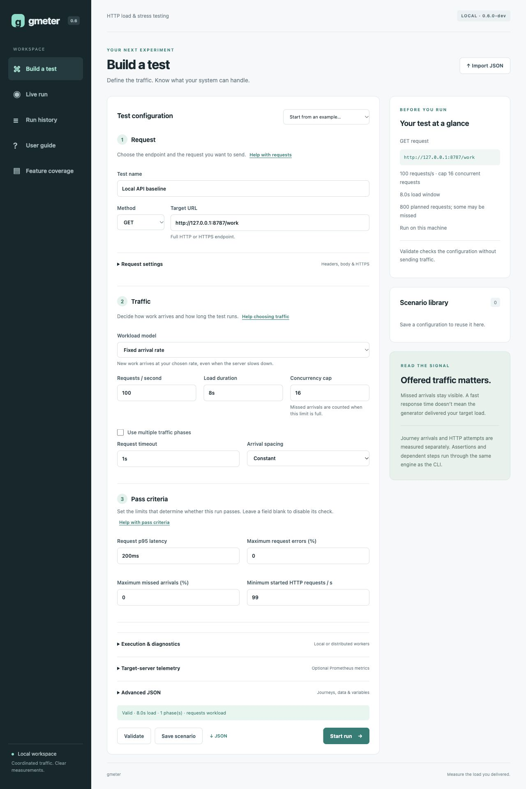
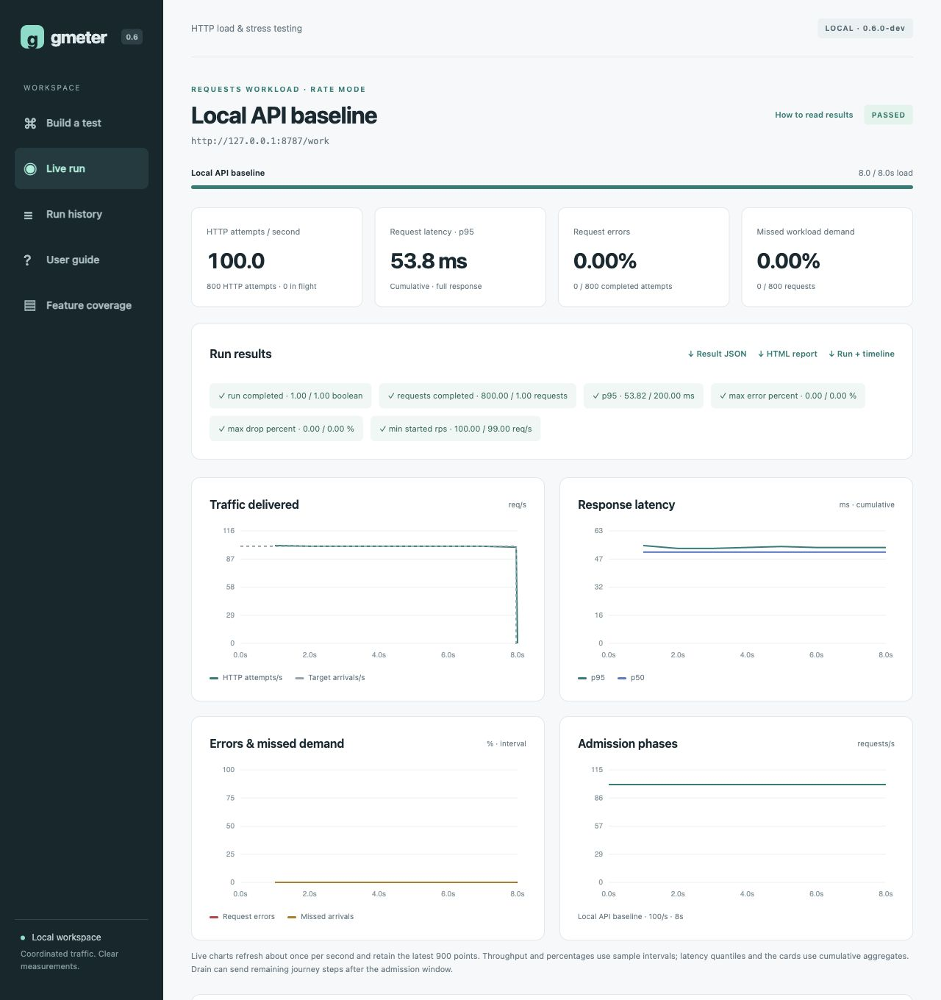

# Local browser dashboard

[Documentation](README.md) · [Project overview](../README.md)

```sh
make build
./bin/gmeter ui
```

Open the printed URL, normally **http://127.0.0.1:8790**. The binary includes the
app and seven starter configurations. Node and external assets are not needed.
Start `./bin/gmeter-demo` separately to use examples on port 8787.

```sh
./bin/gmeter ui -listen 127.0.0.1:8791 -data /path/to/workspace
./bin/gmeter ui -listen '[::1]:8790'
```

The listen address must be an explicit loopback IP and port. Port `0` selects an
available port. The default data directory is `.gmeter/` in the current directory.

## App overview



For a first test, follow [getting started](getting-started.md) or open **User guide**
in the app. See [operations](operations.md) for workspace ownership, retention,
backup, and recovery, and [security](../SECURITY.md) for trust boundaries.

## Build and reuse tests

The form edits target, model, duration, rate or users, concurrency cap, timeout,
arrival spacing, diagnostics, and optional target-server telemetry. **Advanced JSON** supports every CLI configuration field,
including headers, bodies, phases, data rows, journeys, assertions, and thresholds.
See [scenarios.md](scenarios.md) for journey syntax.

Both editors update the same configuration. With phases present, their rates
and durations control the workload; the single-duration/rate fields are hidden.
**Use a single rate** removes phases and sets a rate of 20/s. Switching to users
mode removes rate phases and jitter; switching to rate mode removes think time.
Journey tests label rates as journeys/second and put HTTP methods on steps.

**Validate** uses the strict parser and engine validation without sending traffic.
Starting a run validates again. Unknown fields and trailing JSON are rejected.
Configuration imports have the same 1 MiB limit as the CLI.

**Workers** accepts origins on separate lines. An empty field executes locally;
worker pools support fixed arrival rates and use the configured rate/concurrency
as fleet totals. The dashboard must inherit `GMETER_WORKER_TOKEN` at startup.
Remote origins require HTTPS. See [workers.md](workers.md) for worker setup,
clock estimation, fixed quotas, leases, and incomplete measurements.

**Target-server telemetry** configures a Prometheus text endpoint, cadence,
timeout, selected scalar series, and optional environment bearer authentication.
Leave the endpoint blank to disable it. Invalid selected-metrics JSON blocks
validation, saving, and starting until corrected. The new server telemetry
starter uses the rebuilt demo's `/metrics` endpoint. The dashboard reads
`GMETER_TELEMETRY_TOKEN` and optional `GMETER_TELEMETRY_CA` at startup; their
values do not enter browser payloads or exports. See [telemetry.md](telemetry.md).

**Save scenario** creates a library entry. After loading it, **Update scenario**
changes that entry. **Save editor as a new scenario** makes a separate copy.
**Import JSON** loads a validated configuration without saving or executing it.
**JSON** exports the current editor, preserving `null` for disabled checks.
Exports validate the editor first and use a native browser download. The server
retains at most 16 temporary configuration exports for five minutes in memory.

## Live measurements



Only one dashboard run can be active. Independently started CLI processes are
not coordinated with the dashboard, though each worker rejects a second active
reservation. Closing or reloading the browser does not stop a run: it belongs
to the dashboard process. Reopening reconnects to the current run. **Stop run**
cancels admission and active requests and saves partial results. Ctrl+C or SIGTERM
on the dashboard also cancels and saves before exit.

Charts refresh about once per second. Short runs still get initial/final samples.

- Traffic lines divide changes in started counters by wall time between samples.
  Journeys show both HTTP attempts/s and journeys/s; their target is journeys/s.
- Interval error percentages use failed/completed differences; missed-demand
  percentages use dropped/scheduled workload differences. No denominator means
  no point.
- Latency p50/p95 lines are cumulative histogram estimates, not interval
  quantiles. Cumulative quantiles cannot be subtracted to get interval quantiles.
- Cards use cumulative metrics and load-window throughput, matching the CLI.
  Interval charts use wall time and can show HTTP steps during journey drain.
- The phase chart shows the configured admission schedule (or user count).
  Live phase labels follow the current admission phase, then drain. Previously
  admitted journeys can still send steps after a phase transition.

The timeline retains the latest **900 samples**, roughly 15 minutes. Final
aggregates cover the whole run. No individual response samples or bodies are
stored. When diagnostics are enabled, the generator panel shows process CPU,
Go heap and runtime memory charts, resident-memory lifetime peak, goroutines,
GC, and workload arrival delay. The HTTP panel shows interval quantiles, sample
counts, connection reuse, protocols, and failures. A missing interval sample is
displayed as a dash. Older runs and runs with diagnostics disabled show a
message explaining that diagnostics were not recorded.

CPU charts show the last sampling interval; finished cards show the run average.
100% means one CPU core. Generator measurements include dashboard work in the
same process. Resident peak includes earlier runs, while Go heap and runtime
peaks cover the current sampled window. These are generator measurements, not
target-server telemetry. See [diagnostics.md](diagnostics.md) for the contract.
Distributed runs show worker status, assignment coverage, and per-worker CPU/heap
summaries. Global counts use only received final results when workers are lost;
the incomplete-worker warning remains visible even if measured errors are zero.

The telemetry panel shows scrape coverage, per-series values/issues, and a
selectable sampled-gauge or observed-counter-rate chart. Finished views add
whole-run summaries and use the collector's latest 900 full scrape observations;
live polling can skip intermediate scrapes. Missing values break the line; zero
is a valid measurement. Counter resets and gaps exclude unknown increases.
Telemetry requests are excluded from workload counters and load checks.

## History and portable files

Finished and interrupted runs persist across restarts. Each stores configuration,
final results (schema 3 locally, schema 4 for workers, schema 5 with telemetry),
and its retained timeline. If the process ends before
final persistence, its reservation appears as **abandoned** at the next startup.
That run is incomplete and cannot be resumed or compared.

Select two runs to compare target, workload, counts, throughput, latency, errors,
missed demand, and available timing and resource diagnostics. Differences are B minus A, with relative changes when A is
nonzero. Percentages differ in percentage points. Different conditions and
partial runs, diagnostics instrumentation, telemetry settings, and generator environments are flagged. Comparison is descriptive, without an automatic
regression verdict.

| Download | Contents | Importable |
| --- | --- | --- |
| Editor JSON | Reusable configuration | Yes |
| Result JSON | Same schema 3/4/5 measurements as the CLI | No; configuration is absent |
| HTML report | Standalone report | No |
| Run + timeline | Configuration, final results, retained timeline | Yes |

Use **Import JSON** or **Import run** for run bundles. Imports require final
schema 2–5 results, validate configuration, final count equations, and telemetry
observation bounds/accounting when present, have a 16 MiB
limit, and assign a new ID. They send no traffic. Imported runs are marked
**IMPORTED**; their original traffic has not been independently verified.
Importing the same file twice makes two history entries. CLI result JSON alone
is not a run bundle.

The workspace supports 200 saved scenarios and 1000 runs. Export entries before
deleting them if needed. If final persistence fails, the current result remains
available for export and new runs are blocked until the process is restarted.

## Access and storage

The server accepts its exact startup host and rejects cross-site origins. API
requests require a random startup token from the page. Native downloads use an
HttpOnly, SameSite=Strict session cookie restricted to download paths; it cannot
authorize API mutations. Tokens never appear in download URLs. A restrictive
content security policy protects the app, and user-provided names render as text.

Saved files are atomic and owner-readable (0600); new workspace directories use
0700. Existing directory permissions are not changed. Saved configurations and
run bundles include supplied headers, bodies, and data rows, which can contain
credentials. Result JSON and HTML omit headers and bodies but include target URLs.

This is a local single-user app without accounts, encryption at rest, remote
access, or multi-user controls. Traffic is sent only after explicitly starting a
run. A fair comparison against JMeter remains a later milestone.

## Guided builder and coverage audit

The builder groups configuration into **Request**, **Traffic**, and **Pass
criteria**. Request settings expose header rows, a raw body, success status
codes, and the [insecure HTTPS option](https.md). Traffic includes a phase editor
with add/remove controls and zero-rate pauses. Blank pass criteria disable their
checks; explicit zero remains a zero limit. The preview distinguishes planned
arrivals from actual work and explains users-mode throughput. Optional worker,
diagnostic, and telemetry settings fold away. Advanced JSON remains available
for journey steps, data, variables, and whole-journey/scenario checks.

Invalid form drafts block validation, saving, export, and execution rather than
using an older serialized configuration. Editing valid JSON repopulates the form.
Run checks and downloads appear before diagnostic charts. Run history supports
name/result search, and changing views clears stale status notices.

**Feature coverage** is a searchable comparison against bundled JMeter 5.6.3,
with available, partial, and not-available families and official manual links.
The [parity program](jmeter-parity.md) defines the backlog and completion gates.
Backlog rows do not enable features.

## In-app user guide

**User guide** is always available from the sidebar. It covers a first local test,
requests, traffic models, pass criteria, interpreting results, reusable workflows,
and troubleshooting. Help links beside Request, Traffic, Pass criteria, Results,
and History open the relevant topic. Guide shortcuts return to the matching
builder field while preserving its current draft.

The walkthrough can load a practice configuration: GET to the demo on port 8787,
5 requests/s for 2s, concurrency 2, request timeout 1s, p95 limit 200ms, and no
allowed request errors or missed arrivals. This plans 10 arrivals. Loading
replaces only the editor draft after an explicit button click; it does not save
a scenario, start the demo, or send workload traffic. The user must start the
demo separately, Validate, then Start run.

A welcome tip introduces the guide. Hide tip remembers a browser-local
preference; User guide remains available. Show welcome tip again restores it.
If browser storage is unavailable, the guide still works and the tip may return
on the next visit. The guide does not mark a test complete just because the
user opened a topic or loaded a preset.
