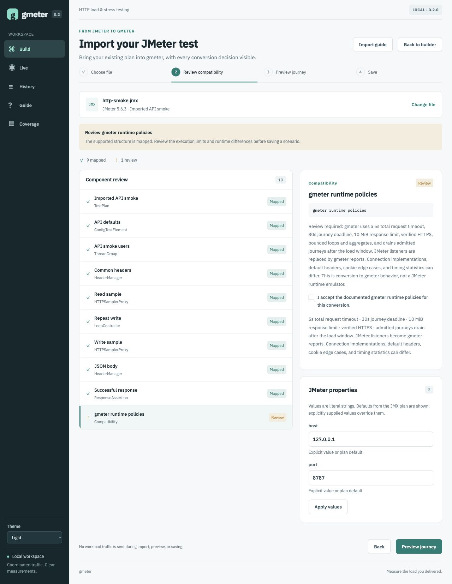

# Import a JMeter test plan

[Documentation](README.md) · [Dashboard](dashboard.md) · [Coverage program](jmeter-parity.md)

**Build → Import JMeter JMX** opens a guided review of an existing `.jmx` file.
This first converter targets JMeter **5.6.3**, XML format **1.2**, and a limited
set of HTTP plans. It converts eligible plans into native gmeter journeys. It
does not run JMeter or provide full JMX compatibility or round-trip export.

## Walk through an import

1. **Choose file.** Select or drop a JMX file up to 1 MiB. **Review sample plan**
   loads the bundled [HTTP fixture](../examples/jmx/http-smoke.jmx) without
   reading a local file. Its target is the local demo on port 8787.
2. **Review compatibility.** Select a component to inspect its source path and
   mapping. Supply any required `__P` property values and press **Apply values**.
   Review and accept the gmeter runtime policies. Acceptance does not remove
   component blockers.
3. **Preview journey.** Eligible plans show the mapped flow canvas. Select nodes
   to inspect requests and loops. A blocked plan shows its source hierarchy,
   clearly marked **Not runnable**, without a partial executable configuration.
4. **Save.** Give the import a name. **Save scenario** is available only after
   all blockers and missing inputs are resolved and runtime policies accepted.
   **Save migration draft** preserves work that cannot yet run.

Importing, reviewing, previewing, and saving send **no workload requests**.
They do not replace your builder draft. **Open in journey builder** explicitly
loads the saved scenario; **Start run** is a separate action that sends traffic.
Start the bundled demo with `./bin/gmeter-demo` before running the sample.

## What this converter accepts

| Source feature | Mapping and limits |
| --- | --- |
| Standard Thread Group | Exactly one enabled group; scheduler enabled; duration 1–86400 seconds; infinite outer iterations; 1–100000 users; zero ramp and startup delay; **Start Next Thread Loop** on error; retained user state |
| HTTP Request | One HTTP/HTTPS origin; explicit Follow Redirects off; keep-alive; default or HttpClient4 implementation; UTF-8; relative paths or literal absolute URLs |
| Request content | Methods and paths, scoped headers, one raw body argument, constant encoded GET arguments; variable references in paths, headers and raw bodies |
| HTTP Request Defaults | Scoped scalar defaults flattened into requests; arguments on defaults are blocked |
| Variables and properties | Static user-defined variables resolved in declaration order; `${name}` becomes `{{name}}` in request templates; literal `__P(name)` inputs and `__P(name,default)` defaults |
| Simple Controller | Flattens its ordered children while retaining scoped settings |
| Loop Controller | Fixed 1–1000 iterations; native nesting and worst-case execution limits also apply |
| Response Assertion | One literal body **Substring** pattern, or one literal response-code **Equals** pattern; parent scope only; non-2xx code assertions require Ignore Status |
| Cookie Manager | Optional standard policy covering the whole group; no preloaded cookies, resets, or custom implementation. Without one, imported journeys explicitly disable cookies |
| Disabled components | Disabled subtrees do not execute; their XML remains in the retained original source |
| Result listeners | Visible notice: gmeter reports replace JMeter listeners; no JTL or configured listener file is written |

Unknown enabled components, properties, incompatible XML property types, and
unsupported scopes block conversion. Among the current blockers are finite
thread-group iterations, multiple groups, ramps, different failure actions,
CSV files, extractors, timers, If/While controllers, scripts, plugins, redirects,
uploads, form encoding, custom HTTP timeouts, authentication managers, proxies,
and cross-origin flows. Native gmeter supports some related features, including
branches, while loops and extraction; that does not imply a reviewed JMX mapping.

The bounds above are validation limits, not demonstrated generator capacity.
The component/property allowlist and tests live in `internal/jmx`.

## Runtime policies you must review

Converted plans use gmeter's 5-second **total** request timeout, 30-second
whole-journey deadline, 10 MiB response limit, bounded loops, and aggregated
measurements. Admitted journeys drain after the load window. HTTPS certificates
are verified. JMeter connection implementations, default headers, cookie edge
cases, timing statistics, and listener output can differ. This is an explicit
conversion to gmeter behavior, not a JMeter runtime emulator.

Explicit source settings without a supported mapping remain blockers even when
you accept these policies. After conversion, you may edit the native scenario
in the builder, including its timeouts and HTTPS setting. Those later edits do
not rewrite the retained original XML.

## Drafts, original source, and storage

**Migration drafts** appears below the Scenario library. Drafts are separate,
non-runnable records, limited to 50 per workspace. Reopening reanalyzes the source
using the current converter. To fix a source blocker, edit a copy in JMeter and
choose the revised file; accepting the runtime review cannot bypass a blocker.

Saved scenarios retain their original JMX and explicitly supplied property
values. **Review original JMX** in the Scenario library opens that original
conversion, which may differ from subsequent builder edits. Native configuration
JSON exports contain the converted configuration, not this source provenance.

Records live in `<workspace>/migrations/` and `<workspace>/scenarios/`, under the
directory selected by `gmeter ui -data` (default `.gmeter`). Files are written
atomically with owner-only permissions. Workspace data is **not encrypted at
rest**. XML, bodies, headers, properties, and backups may contain credentials;
protect and retain them as carefully as native test configurations.

The parser rejects DTDs, external entities, namespaces, malformed component
pairs, excessive structure, and multiple documents. It never opens referenced
files, loads local JMeter properties, evaluates scripts, or contacts targets.
Limits include 500 components, 20000 XML elements, XML depth 64, and 64 explicit
properties. Server-side conversion reanalyzes the XML instead of trusting a
client-supplied compatibility report or configuration.

## Compatibility evidence

Tests cover accepted and blocked mappings, malformed XML, property resolution,
draft persistence, source retention, owner-only files, API authorization, and
rejection of forged runnable configurations. A counted local HTTP target checks
methods, URLs, headers, payloads, loop request counts, and absence of implicit
cookies. These checks do not establish equivalence with every JMeter plan;
cross-engine conformance remains part of the [parity program](jmeter-parity.md).

Source semantics are grounded in Apache's [component reference](https://jmeter.apache.org/usermanual/component_reference.html)
and [test-plan documentation](https://jmeter.apache.org/usermanual/test_plan.html).
The bundled fixture is authored for this converter; it is not a claim that all
JMeter HTTP plans can be imported.
